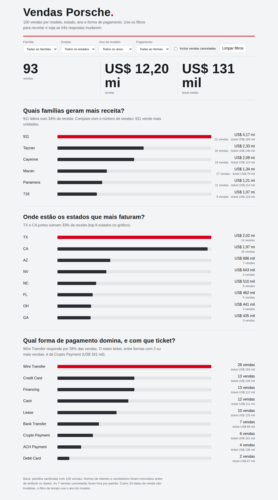
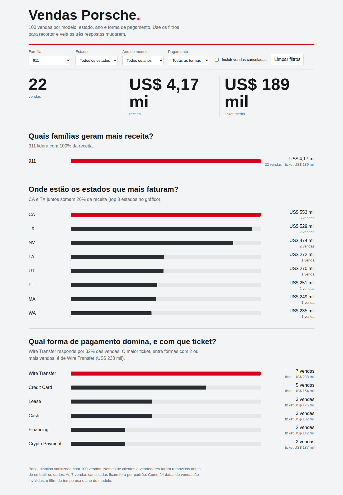

# Dashboard de vendas Porsche

Dashboard interativa em HTML (arquivo único) com 100 vendas da Porsche, feita para o desafio da DIO. Responde três perguntas de negócio e permite recortar os dados por filtros.

**Dashboard publicada:** https://cesarochal.github.io/dashboard-porsche-vendas/




## Perguntas de negócio

1. **Quais famílias de modelo geram mais receita?** Os 41 modelos são demais para comparar, então agrupei em 6 famílias (911, 718, Cayenne, Macan, Panamera e Taycan). Mostra se a família que mais vende em unidades é a que mais fatura.
2. **Onde estão os estados que mais faturam?** Revela onde a demanda se concentra. Texas e Califórnia lideram com folga.
3. **Qual forma de pagamento domina, e com que ticket médio?** Mostra o perfil de compra e se algum meio de pagamento concentra vendas mais caras.

## Filtros e indicadores

- Filtros: família, estado, ano do modelo, forma de pagamento e opção de incluir vendas canceladas.
- Indicadores de topo: total de vendas, receita e ticket médio.

## Tratamento da base

A planilha tinha cada campo em duas versões, a crua e a sanitizada. O que foi feito antes de usar a IA:

- Mantive só as colunas sanitizadas (modelo, ano, preço, forma de pagamento, cidade, estado e status de entrega).
- Removi nomes de clientes e de vendedores, porque a base fica embutida no HTML público.
- Conferi que preço e ano estavam como número.
- Criei a coluna de família a partir do nome do modelo.
- As 7 vendas canceladas ficam fora por padrão (dá para incluí-las no filtro).
- 24 datas de venda estavam como `INVALID`, então usei o ano do modelo como filtro de tempo em vez da data da venda.

## Ferramenta usada

Claude (Anthropic), gerando o HTML diretamente a partir da planilha. Publicado com GitHub Pages. Não usei ChatGPT com Canvas nem agente com skill.

## Prompt

Versão inicial:

```
Tenho uma planilha com 100 vendas da Porsche (modelo, ano, preço, forma
de pagamento, cidade, estado, status de entrega). Monte uma dashboard em
HTML de arquivo único, com os dados embutidos, que responda três perguntas:
(1) quais famílias de modelo geram mais receita, (2) quais estados mais
faturam, (3) qual forma de pagamento domina e com que ticket médio.
Inclua filtros por família, estado, ano e pagamento, e indicadores de topo
(vendas, receita, ticket médio). Visual inspirado na Porsche: vermelho,
grafite e cinza-claro, tipografia condensada, sem bibliotecas externas.
```

O que mudou até a versão final:

- Troquei a análise por cidade pela análise por estado, porque a base tem 79 cidades, quase todas com só 1 ou 2 vendas, o que deixava o gráfico ilegível.
- Agrupei os 41 modelos em 6 famílias para o primeiro gráfico caber na tela.
- Passei a excluir as vendas canceladas por padrão, com uma caixa para incluí-las.
- Limitei o gráfico de estados ao top 8.
- Usei o ano do modelo como filtro de tempo, porque 24 datas de venda eram inválidas.
- Corrigi o plural nos rótulos ("1 venda" em vez de "1 vendas").

## Como rodar

Abra o `index.html` no navegador ou acesse o link da dashboard publicada. Não precisa instalar nada.
